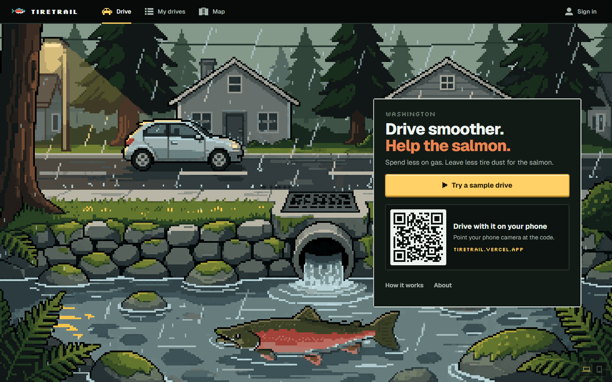
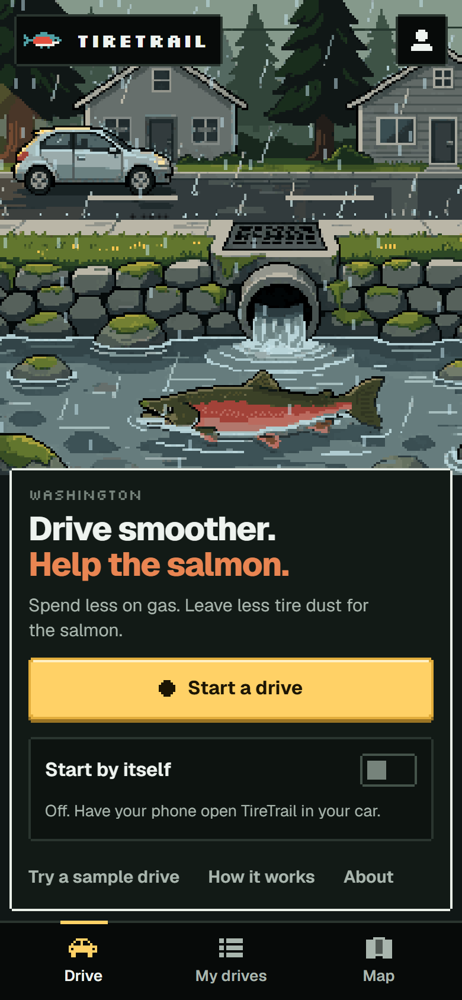
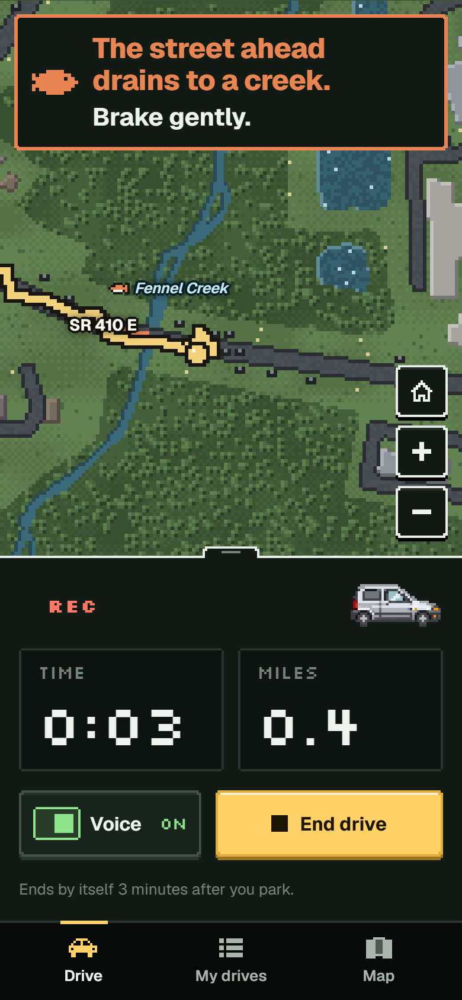
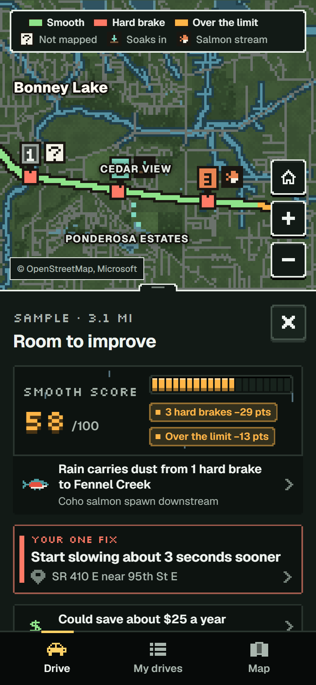
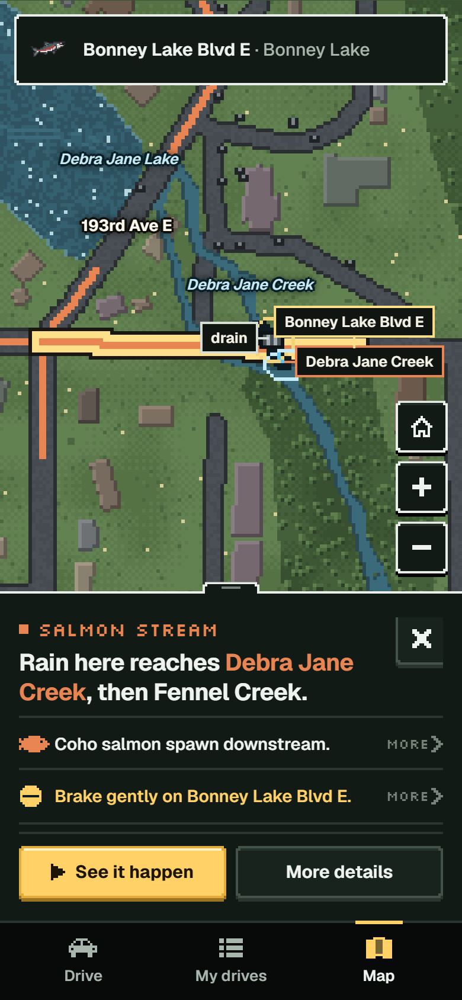
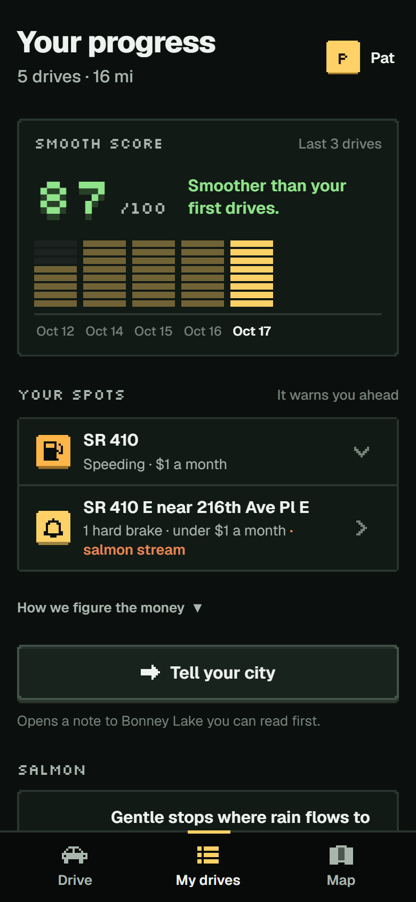

# TireTrail

TireTrail is a driving coach for Washington. It tells you when you brake hard and about how much gas that wastes. It also shows where the tire dust from your street goes when it rains.

## Why

Hard stops wear dust off your tires. Rain washes that dust into storm drains, and some drains flow into creeks. A chemical in the dust can kill coho salmon within hours of a storm.

Smoother driving leaves less dust behind. It saves gas too.

## What it does

  
  
  
  
  

TireTrail uses your phone's GPS and motion sensor while you drive. When you brake hard, it tells you. It learns where you often brake hard and warns you before you get there.

After each drive you get one thing to fix, the salmon creeks you crossed gently, and about how many cents of each gallon went to hard brakes and fast starts.

The map shows where rain from a street ends up, following the storm pipes to a creek or into the ground. When a pipe map has a gap, it says so.

## How it is built

TypeScript, Vite and Firebase. Storm drains are traced ahead of time from city and county pipe maps. Drives are analyzed on the phone.

## Data

Pipe maps from Bonney Lake, Tacoma, Puyallup, Sumner, Auburn, Bellevue, Renton, Mercer Island, Maple Valley, Covington, Seattle Public Utilities, King County and Pierce County. Salmon and steelhead streams from WDFW and NWIFC (SWIFD). Forecasts from the National Weather Service. Streams and lakes from USGS. Roads and towns from OpenStreetMap. Buildings from Microsoft. Terrain from USGS elevation data.

TireTrail is an independent student project and is not endorsed by these agencies.

## License

Copyright 2026 Ashwath Polali. All rights reserved. See [LICENSE](LICENSE).
